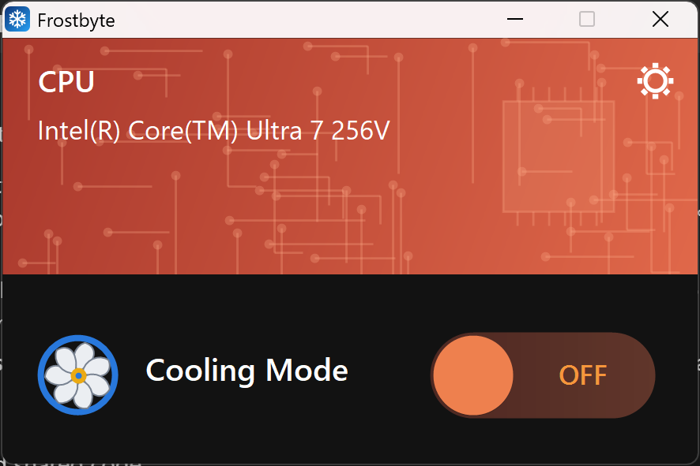
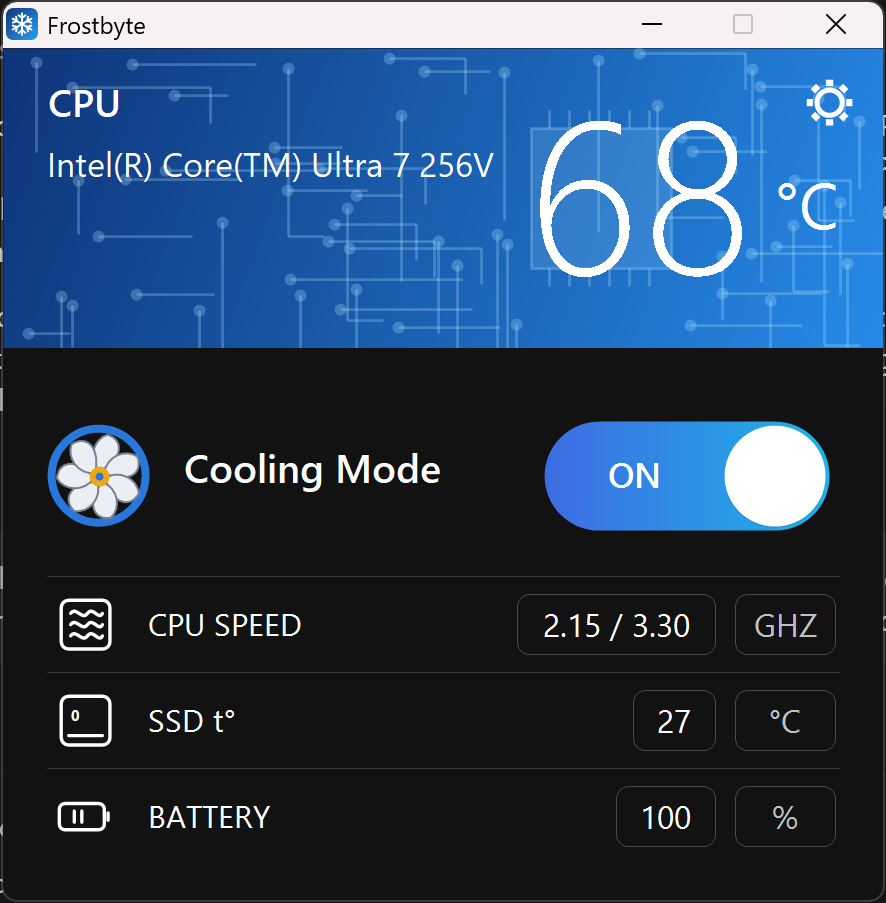
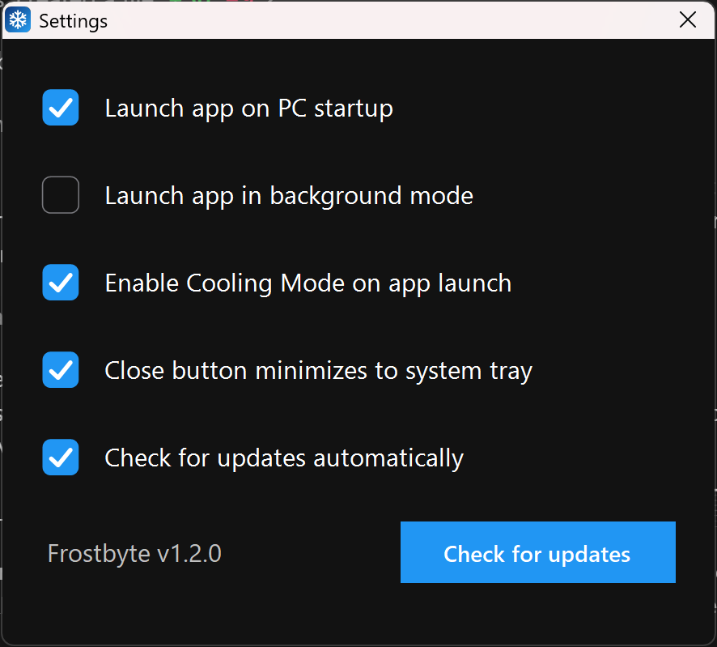

# ❄️ Frostbyte

**One click to run your PC cooler and quieter.**

Frostbyte is a tiny Windows app with a single big switch: **Cooling Mode**. Turn it on and your processor (CPU) stops pushing itself to its absolute maximum speed. That means less heat, a calmer fan, and often better battery life, at the cost of some peak performance. Turn it off and everything goes back exactly as it was.

| Cooling Mode OFF | Cooling Mode ON |
|---|---|
|  |  |

It's free and open source (MIT license).

---

## Get started (2 minutes)

### 1. Download
Go to the **[Releases page](https://github.com/scuba3198/Frostbyte/releases/latest)** and download **`Frostbyte-Setup-x.y.z.exe`**.

### 2. Install
Double-click the file you downloaded and follow the steps (Next → Next → Install). On the options page you can choose whether to create a **Start Menu shortcut**, a **desktop shortcut**, and whether Frostbyte should **launch automatically when you sign in to Windows**. (You can change the last one later in Settings.)

> **Windows says "Windows protected your PC"?**
> That's normal for a new, small app that isn't digitally signed (code-signing certificates cost money). Click **More info**, then **Run anyway**. You can read all of the source code in this repository if you'd like to check what it does.

### 3. Use it
1. Open **Frostbyte** from the Start menu or desktop.
2. Click the big switch so it says **ON** (the window turns blue). Click again to turn it **OFF** (the window turns orange).

That's it. You can leave it on all the time or just switch it on when your laptop gets hot or loud.

Frostbyte asks for **administrator permission** when it opens. That's required because it changes a Windows power setting, and Windows only lets administrators do that.

---

## Settings

Click the **⚙ gear** in the top-right corner.



| Setting | What it does |
|---|---|
| **Launch app on PC startup** | Frostbyte starts by itself when you sign in to Windows, with no extra permission pop-up. |
| **Launch app in background mode** | Starts hidden in the system tray (the little icons near the clock) instead of opening a window. |
| **Enable Cooling Mode on app launch** | Switches Cooling Mode on every time Frostbyte starts. Combine this with the two options above for "set and forget". |
| **Close button minimizes to system tray** | Clicking **X** hides the window instead of quitting. Frostbyte keeps running in the tray. |

### The tray icon
Look near the clock (you may need to click the **^** arrow). The snowflake icon is **blue when Cooling Mode is on** and **orange when it's off**.
- **Left-click** it to open the window.
- **Right-click** it for a menu: open, switch Cooling Mode on/off, or **Exit** to quit completely.

---

## Questions

**Is it safe?**
Yes. Frostbyte only creates and switches a normal Windows *power plan*, the same thing you'd find under *Control Panel → Power Options*. It doesn't touch your hardware directly, install drivers, or connect to the internet.

**Will it slow my PC down?**
Only a little, and only when your CPU would otherwise be pushing to its very top speed (for example in games or heavy exports). Everyday use (browsing, documents, video) usually feels the same.

**How do I turn it off completely?**
Switch Cooling Mode to **OFF**, or just uninstall Frostbyte. Uninstalling automatically switches Cooling Mode off and removes the startup entry, so you're never left in a changed state.

**Frostbyte says it needs to run as administrator.**
Accept the Windows prompt (UAC). It can't work without it.

**Does it work on desktops and AMD CPUs?**
It uses standard Windows power settings, so it works on any Windows PC. How much cooler it gets depends on your CPU and how it handles the "boost" speeds. It was built and tested on an Intel laptop.

**Why isn't there a temperature display?**
Reading a CPU's true temperature reliably needs a special hardware driver. I decided to keep Frostbyte driver-free and simple, so it doesn't show temperatures.

**Windows Security / antivirus flagged it.**
Small unsigned apps sometimes get flagged by mistake. The full source is here and you can build it yourself (see below).

---

## How it works (for the curious)

Everything Frostbyte does comes down to **one Windows power plan** and a handful of settings in it.

### What "Cooling Mode" actually changes
When you switch it **ON**, Frostbyte:

1. **Remembers** which power plan is active right now.
2. **Copies the built-in *Balanced* plan** into a new plan called **"Frostbyte"** (if Balanced is missing, it copies the currently active plan instead).
3. **Writes five processor settings** into that new plan:

   | Setting (Windows name) | AC (plugged in) | DC (battery) |
   |---|---|---|
   | Processor performance boost mode | Disabled (0) | Disabled (0) |
   | Minimum processor state | 5% | not changed |
   | Maximum processor state | **99%** | **99%** |

4. **Activates** the Frostbyte plan.

When you switch it **OFF**, it re-activates the plan from step 1 (Balanced if that's gone) and **deletes** the Frostbyte plan, leaving no trace.

### Why 99%?
Modern CPUs run at their normal "base" speed and then briefly **boost** well above it. Boosting is what makes them run hot and draw lots of power. Setting the maximum state to **99%** (just under 100%) is a widely used trick that stops Windows from engaging boost, and the boost-mode setting is also explicitly set to Disabled. The CPU still runs at full base speed, so it stays responsive, but it stops producing the short, hot bursts.

### Where this came from
The behavior was worked out by observing a comparable commercial tool's actual effect on Windows power settings (using static and runtime analysis, for interoperability) and then **re-implementing it from scratch**. The five settings above are the ones that tool writes. No code, images or other assets from it are included in this project.

### The pieces
| File | Role |
|---|---|
| `CoolMode.cs` | The core: creates/activates/deletes the power plan using Windows' `powrprof.dll` API (`PowerDuplicateScheme`, `PowerWriteACValueIndex`, `PowerWriteDCValueIndex`, `PowerSetActiveScheme`, …). Also builds the command-line tool `CoolMode.exe`. |
| `CoolModeGui.cs` | The window, settings dialog and tray icon (Windows Forms, all custom-drawn). |
| `Settings.cs` | Saves your choices to `%AppData%\Frostbyte\settings.ini` and manages the startup task. |
| `Logo.cs`, `tools/IconGen.cs` | The logo is drawn in code; the icon generator turns it into `Frostbyte.ico`. |
| `installer.iss` | The [Inno Setup](https://jrsoftware.org/isinfo.php) script for the installer. |
| `build.ps1` | Builds everything using only the compiler that ships with Windows. |

### Details worth knowing
- **Why admin?** Writing to power plans requires administrator rights, so both programs carry a manifest asking for elevation.
- **How "launch on startup" works:** a normal startup entry can't launch an admin app without a UAC prompt. Frostbyte instead registers a **Task Scheduler** task ("Frostbyte") that runs at sign-in with the highest privileges. It is configured to start even on battery power, which Task Scheduler blocks by default. Turning the option off or uninstalling deletes the task.
- **One copy at a time:** launching Frostbyte again just brings the existing window to the front.
- **Sharp on any screen:** the app declares itself DPI-aware and scales its own layout, so text isn't blurry on high-resolution or scaled displays.
- **Where settings live:** `%AppData%\Frostbyte\settings.ini`, a few `key=1/0` lines you can edit or delete.

### Command line
`CoolMode.exe` (installed next to Frostbyte) does the same thing without a window:

```
CoolMode.exe on        switch Cooling Mode on
CoolMode.exe off       switch it off
CoolMode.exe toggle    flip it
CoolMode.exe status    prints ON/OFF (exit code 1 = on, 0 = off)
```

### Build it yourself
You only need Windows. No SDKs or package managers.

```powershell
powershell -File build.ps1
```

This produces `Frostbyte.ico`, `Frostbyte.exe` and `CoolMode.exe`. To also build the installer, install [Inno Setup 6](https://jrsoftware.org/isinfo.php) and run:

```
ISCC.exe installer.iss
```

The installer appears in `dist\`.

---

## License
MIT. See [LICENSE](LICENSE). Contributions and issues are welcome.
